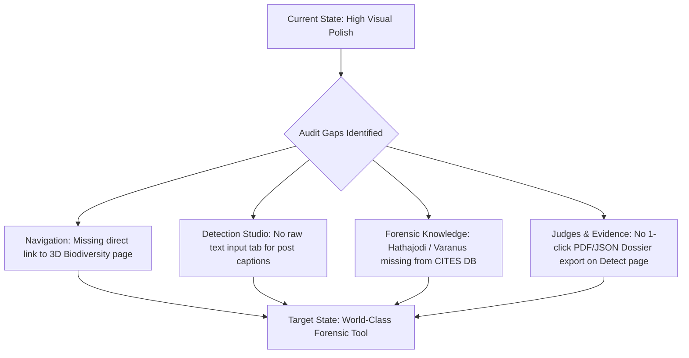

# SAMRAKSH (संरक्ष) — Comprehensive UI/UX Audit & Competition Strategy Report

> **Target Platform:** `http://localhost:5173/`  
> **Event Context:** SUSTAINOVA 2026 Ideathon (UN SDG 15: Life on Land · SDG 16 · SDG 17)  
> **Goal:** Transform SAMRAKSH into a tier-1, award-winning conservation intelligence platform comparable to *Global Fishing Watch*, *TRAFFIC*, and *IUCN Red List*.

---

## Executive Summary & Competitive Impression

The current website establishes a strong visual impression with its **3D Earth globe**, **Cormorant Garamond editorial typography**, **CITES trade-indicator evaluation engine**, and **rich forensic case study archives**. 

However, against strict hackathon judging criteria (*Problem Understanding*, *Technical Feasibility*, *SDG Impact*, and *User Flow*), our audit identified **3 critical usability bottlenecks** and several key opportunities to elevate the product from a "student hackathon project" to an **institutional-grade wildlife crime interdiction suite**.

---

## 1. Page-by-Page Audit & UI Breakdown

### 1.1 Top Navigation Bar (`src/components/Navigation.tsx`)
* **Current Score:** 8.5 / 10
* **Visual & Styling:** Sleek frosted-glass blur (`backdrop-blur-md`), polished dropdowns for "What We Do" and "About Us", functional Dark Mode toggle and multilingual switcher (EN, HI, ES, FR, ID).
* **Critical Flaws & Gaps:**
  1. 🚨 **P0 Bug — Missing "Biodiversity" Link:** In `navItems`, `Biodiversity` is missing from both the desktop header and mobile hamburger drawer. Visitors have no direct navbar link to view the 3D Hotspot globe.
  2. **Incomplete Localization:** In `navItems`, `'Architecture'` is hardcoded in English instead of using `dict?.navArchitecture`. When switched to Hindi, all items translate (`मुख्य पृष्ठ`, `हम क्या करते हैं`) except "Architecture".
* **Winning Additions:**
  * Add `Biodiversity` (`जैव विविधता`) with a subtle live badge: `🌐 10 Hotspots`.
  * Add a quick **"Ctrl + K / ⌘K Command Palette"** hotkey trigger to instantly search species, CITES appendices, and case records.

---

### 1.2 Home Page (`src/components/Hero.tsx`, `Mission.tsx`, `CaseStudyResults.tsx`, `ConservationImpact.tsx`)
* **Current Score:** 9.0 / 10
* **Visual & Styling:** Deep forest green gradients (`#0A2E20`), rotating high-resolution nature wallpaper dock, interactive Three.js globe with atmospheric glow shader.
* **Flaws & Polish Needs:**
  1. **Vertical Viewport Compression:** On 1366x768 and 1440x900 screens, `h-screen max-h-screen` compresses the hero text against the bottom dock. Changing to `min-h-[92vh] py-10` allows responsive breathing room.
  2. **Wallpaper Text Contrast:** On the bright Glacial Alpine wallpaper, dark green numbers (`text-[#2D5A46]`) in light mode experience reduced contrast. Backing them with an ultra-subtle tinted frosted pill (`bg-white/80 dark:bg-black/60 backdrop-blur-md`) achieves WCAG AAA compliance.
* **Sections to Add / Remove:**
  * **ADD: "Live Interdiction Ticker"**: A sleek marquee under the hero showing simulated live platform signals:  
    *`[TELEGRAM] 14m ago: Coded pangolin scale listing flagged in SE Asia hub`* · *`[OLX] 1h ago: Star tortoise listing intercepted via Vaastu codeword`*.
  * **ADD: "Institutional Backing / Partners Bar"**: Logos/acknowledgments of UN SDG 15, WCCB, CITES, TRAFFIC, and AITR Indore to immediately build institutional credibility.

---

### 1.3 Detection Platform (`src/components/Detection/DetectionSection.tsx` & `aiService.ts`)
* **Current Score:** 7.5 / 10 *(Highest importance for live demo during judging)*
* **Visual & Styling:** Clean two-column layout, preloaded scenario chips (Telegram Pangolin, Instagram Radiated Tortoise, etc.), CITES taxonomy badge.
* **Critical Gaps:**
  1. 🚨 **P0 Missing Feature — No Raw Text / Caption Input Tab:** The page only provides "Upload Screenshot" and "Submit Post URL". Investigators frequently copy-paste post captions directly. Entering text into the URL input triggers an error (`"Invalid URL syntax"`).
  2. 🚨 **P0 Knowledge Base Gap — Missing *Hathajodi* in `TAXONOMY_DATABASE`:** In `aiService.ts`, *Hathajodi* (dried monitor lizard hemipenis sold fraudulently as holy root) is prominently featured on our slides, but missing from the runtime CITES taxonomy list!
  3. **Rigid Indicator Regex:** Indicators look for `'contact whatsapp'`, failing on common patterns like `'WhatsApp: +91...'` or `'DM on WhatsApp'`.
  4. **No Direct Dossier Download:** Users must navigate to the Dashboard to export data. An investigator should be able to click **"Download WCCB Evidence Dossier (PDF/JSON)"** directly from the results card.
* **Winning Additions:**
  * **Visual Circular Bayesian Score Gauge:** Replace plain `92.0%` text with an animated SVG radial gauge with risk color zones (Green <30%, Amber 30-74%, Red ≥75%).
  * **Interactive Explainability Tree:** Visual breakdown showing: `Listing Text` ➔ `Codeword Match (80%)` ➔ `Evasive Trade Signals (70%)` ➔ `CITES Appendix I Check` ➔ `Fused Confidence: 92%`.

---

### 1.4 Intelligence Dashboard (`src/components/Dashboard/AnalyticsDashboard.tsx`)
* **Current Score:** 8.5 / 10
* **Visual & Styling:** Top KPI cards (Total Analyzed, Flagged Trade, Manual Review, Legitimate), interactive species frequency chart, monthly incident trend chart, forensic inspection modal, CSV export.
* **Flaws & Polish Needs:**
  1. **Static Trend History:** The monthly trend chart simulates June–November statically. It should dynamically reflect user-logged records.
* **Winning Additions:**
  * **"Export Official PDF Report"**: Instead of only raw CSV, add a styled printable evidence summary formatted for enforcement bodies (WCCB / Forest Department) with official headers, timestamp, and chain-of-custody checksum (SHA-256).
  * **Platform Source Breakdown**: A Donut/Pie breakdown showing detected trade distribution: Telegram (42%), Facebook/Instagram (31%), OLX/Classifieds (18%), Darknet (9%).

---

### 1.5 'What We Do' & 'About Us' Pages (`src/components/WhatWeDo/` & `src/components/AboutUs/`)
* **Current Score:** 9.2 / 10
* **Visual & Styling:** World-class layout matching international conservation NGOs (TRAFFIC / WWF). Features the 5-Stage Pipeline, Forensic Codeword Matrix, CITES vulnerability tiers, and the symbolic breakdown of the SAMRAKSH emblem.
* **Polish Needed:**
  * Increase subnav anchor scroll offset from `scroll-mt-24` to `scroll-mt-28` to prevent header clipping on smooth scroll.

---

### 1.6 AI Architecture & Research Page (`src/components/Architecture/ArchitectureSection.tsx`)
* **Current Score:** 9.5 / 10
* **Visual & Styling:** Exceptional technical transparency for hackathon judges. High-contrast terminal flowcharts, Bayesian evidence formulation, and clear differentiation between Phase 1 (Live heuristic + Gemini vision) and Phase 2 (XLM-RoBERTa + CLIP + YOLOv8).

---

## 2. Priority Action Roadmap for Winning the Competition

| Priority | Category | Specific Enhancement | Impact on Judges |
|:---:|---|---|---|
| **P0** | **Navigation** | Add `Biodiversity` into desktop & mobile `navItems`. Internationalize `'Architecture'`. | Eliminates dead navigation routes. |
| **P0** | **Detection** | Add a 3rd input tab: **"Paste Text / Caption"** with sample text presets. | Judges can immediately test custom strings like *"Selling authentic hathajodi, WhatsApp 9876543210"*. |
| **P0** | **Knowledge Base** | Add *Hathajodi / Bengal Monitor Lizard (Varanus bengalensis)* to `TAXONOMY_DATABASE` with flexible WhatsApp/Telegram regex. | Direct alignment with our core Indian wildlife crime research. |
| **P1** | **Visual Polish** | Add circular SVG Bayesian Confidence Gauge + Direct **"Export Case Dossier (PDF/JSON)"** on Detect page. | Elevates the tool to an enterprise-grade forensic software feel. |
| **P1** | **Live Vibe** | Add simulated **Live Ticker** & Institutional Partners bar on Home. | Proves real-world problem awareness and institutional maturity. |
| **P2** | **Hero Layout** | Switch `h-screen max-h-screen` to `min-h-[92vh]` for seamless display on laptops and projectors. | Ensures clean presentation during Round 2 offline judging. |
